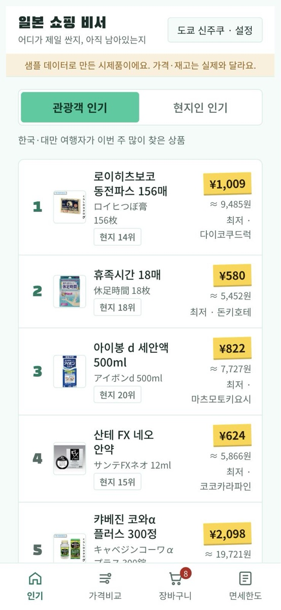
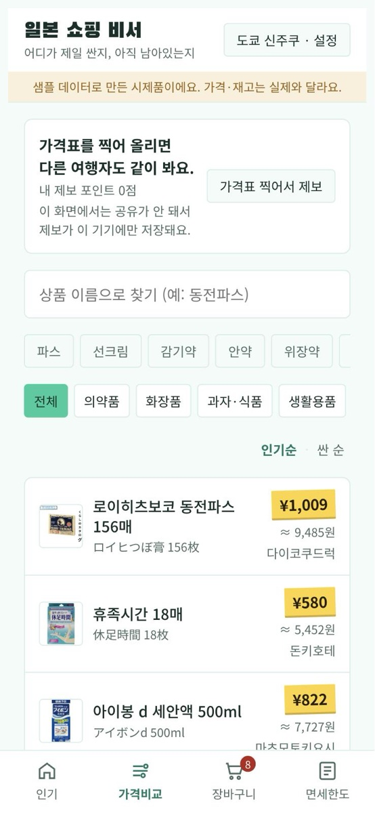
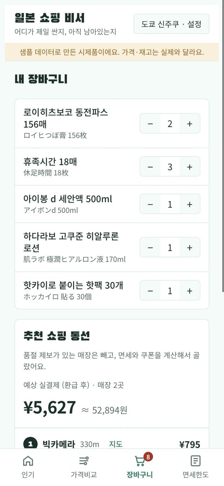
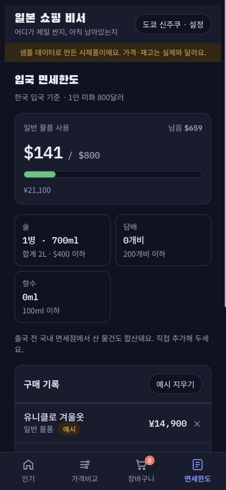

# 일본 쇼핑 비서 (日本購物小幫手)

일본에 여행 가는 한국·대만 여행자를 위한 쇼핑 앱 시제품입니다.
"어디가 제일 싼지, 아직 남아있는지"를 한 화면에서 보여주는 것이 목표입니다.

> **시제품**입니다. 상품 90개의 이름, JAN 코드, 사진, 온라인 참고가는 [Yahoo!ショッピング 商品検索API](https://developer.yahoo.co.jp/webapi/shopping/v3/itemsearch.html)에서 가져온 실제 데이터입니다. 매장별 가격과 재고, 인기 순위는 아직 화면과 흐름을 보여주기 위한 예시입니다.

**바로 써보기**: https://claude.ai/artifact/QapKecHZtx8vicivu6bsKf (Claude 아티팩트, 휴대폰 화면 기준)
※ 링크를 열려면 **Claude 계정으로 로그인**해야 합니다. 로그인하지 않으면 로그인 화면만 보입니다. 계정이 없다면 `japan-shopping/index.html`을 내려받아 브라우저에서 바로 열 수 있습니다 (사진 읽기·제보 공유 제외).

## 화면

<p>




</p>

왼쪽부터 인기, 가격비교, 장바구니, 면세한도 화면입니다 (한국어, 도쿄 신주쿠 기준, 예시 데이터). 상품 사진은 야후 쇼핑에서 가져오고, 사진이 없거나 아직 안 불러온 상품은 "薬", "美容"처럼 분류 글자가 들어간 칸으로 나옵니다.

## 주요 기능

| 탭 | 하는 일 |
|---|---|
| **인기** | "관광객 인기"와 "현지인 인기" 순위를 나눠 보여줍니다. 현지인 탭에는 왜 현지인이 사는지 짧은 설명과 "관광객은 잘 모르는 템" 표시가 붙습니다. |
| **가격비교** | 근처 매장 6곳의 세금 포함 가격, 면세 환급 후 가격, 쿠폰, 거리, 재고 상태를 비교합니다. 최저가에는 노란 가격표가 붙습니다. 상품 사진과 야후 쇼핑 온라인 참고가(판매처 중앙값)도 함께 보여줍니다. |
| **장바구니** | 담은 상품으로 쇼핑 동선을 추천합니다. 품절 제보가 있는 매장은 빼고, 면세 기준(한 매장 하루 5,000엔)과 쿠폰을 따져 어느 매장에서 무엇을 살지 정합니다. |
| **면세한도** | 입국 면세한도(한국 미화 800달러, 대만 NT$35,000)를 추적합니다. 술·담배·향수 별도 한도와 한국 기준 예상 세금(자진신고 감면, 미신고 가산세)도 보여줍니다. |

### 상품 찾기
- 정식 이름(한국어, 중국어, 일본어)과 JAN 코드로 검색합니다.
- 별명과 종류 이름으로도 찾습니다. 예: "샤론파스", "카베진", "선크림", "립밤", "面膜", "防曬".
- 검색창 아래 "자주 찾는 말" 버튼(파스, 선크림, 감기약 등 8개)을 누르면 바로 검색됩니다. 다시 누르면 검색이 지워집니다.
- 한 번 열어 본 상품은 "최근 본 상품" 줄(최대 8개)에 남아서 한 번에 다시 열 수 있습니다. 이 기록은 그 브라우저에만 저장됩니다.
- 매장에서 상품을 못 찾으면 상품 화면의 "점원에게 보여주기"를 누릅니다. 화면 가득 "この商品はどこにありますか？(이 상품 어디 있어요?)"와 상품 사진, 일본어 상품 이름, JAN 바코드가 나와서 점원이 바로 스캔할 수 있습니다. 위의 버튼으로 "재고 있어요?", "면세 돼요?" 문장으로 바꿀 수 있고, 버튼 밖을 누르면 닫힙니다.
- 결과가 없으면 "가격표 찍어서 찾기" 버튼이 나옵니다. 가격표 사진으로 상품을 찾은 뒤 "이 상품 보기"를 누르면 그 상품의 매장별 가격으로 넘어갑니다.

### 가격표 제보
- 가격표나 선반 라벨을 찍으면 Claude가 사진을 읽어 상품과 세전 가격을 채웁니다.
- 제보한 가격과 재고는 다른 여행자에게도 실시간으로 공유됩니다.
- 평소 가격과 50% 넘게 차이 나면 숫자를 다시 확인하라고 알려줍니다.
- 제보할 때마다 포인트가 10점씩 쌓입니다.

### 그 밖에
- 언어: 한국어, 번체 중국어
- 지역: 도쿄 신주쿠, 오사카 난바
- 환율은 예시값이며 설정에서 직접 바꿀 수 있습니다.

## 실행 방법

`japan-shopping/index.html` 하나로 된 페이지입니다. 별도 설치나 빌드가 필요 없습니다.

- **Claude 아티팩트로 열 때** ([링크](https://claude.ai/artifact/QapKecHZtx8vicivu6bsKf), Claude 로그인 필요): 모든 기능이 동작합니다. 가격표 사진 읽기와 제보 공유는 Claude 아티팩트의 런타임 기능(`sample`, `db`, `user`)을 씁니다.
  - 사진 읽기는 보는 사람 본인의 Claude 계정으로 동작해서, Claude에 로그인한 사람만 쓸 수 있습니다.
  - 공개 링크로 들어온 사람은 다른 여행자의 제보를 볼 수 있지만, 자기 제보는 자기 브라우저에만 저장됩니다. 제보를 공유하려면 Contributor 권한이 필요합니다.
- **브라우저에서 파일을 직접 열 때**: 순위, 가격비교, 장바구니, 면세한도는 동작합니다. 사진 자동 읽기와 제보 공유는 꺼지고, 제보는 그 브라우저에만 저장됩니다.

## 반영한 제도 (2026년 11월 기준)

- **일본 면세**: 2026년 11월 1일부터 환급 방식으로 바뀌었습니다. 매장에서는 세금 포함 가격을 내고, 구입 후 90일 안에 출국하면서 세관 확인을 받아야 소비세를 돌려받습니다. 같은 매장에서 같은 날 산 금액이 세전 5,000엔 이상이어야 하고, 일반·소모품 구분과 50만 엔 상한은 없어졌습니다. 환급 수수료는 매장마다 다릅니다. 과자·화장품·약 같은 소모품은 일본에서 일부라도 쓰면 환급받을 수 없고, 세관 확인은 짐을 부치기 전에 받아야 합니다.
- **한국 입국 면세**: 1인 미화 800달러. 술(합계 2L, 400달러 이하, 병 수 제한 없음), 담배 200개비, 향수 100ml는 별도입니다. 초과분 예상 세금은 일반 물품 간이세율 15%로 추정합니다(의류·신발 18% 등 품목별 세율은 반영하지 않음). 자진신고하면 관세 30% 감면(최대 20만 원), 미신고 적발 시 가산세 40%(2년 안에 2회 이상이면 60%).
- **대만 입국 면세**: 1인 NT$35,000 (2024년 6월 26일부터), 술 1.5L (만 18세 이상, 2025년 1월 25일부터, 수입이 허용되지 않은 중국산 술은 1L까지), 담배 200개비 (만 20세 이상).

세금 계산은 참고용입니다. 일본 면세 규칙(90일, 한 매장 하루 세전 5,000엔, 소모품 사용 시 환급 불가, 수하물 위탁 전 세관 확인)은 2026년 11월 15일에 국세청 Q&A와 관광청 안내 원문으로 확인했습니다. 한국·대만 입국 면세 숫자도 같은 날 관세법령과 대만 법규 원문으로 확인했습니다.

참고 자료
- [nippon.com: 免税店での購入、11月から「リファンド方式」に](https://www.nippon.com/ja/japan-data/h02925/)
- [国税庁: Q&A（リファンド方式・概要編）(PDF)](https://www.nta.go.jp/publication/pamph/shohi/menzei/201805/pdf/0025012-025_02.pdf)
- [관광청: 여행자용 리펀드 방식 안내](https://www.mlit.go.jp/kankocho/tax-free/page01_000001_00021.html)
- [관광청 면세 제도 안내 (PDF)](https://www.mlit.go.jp/kankocho/tax-free/content/001978459.pdf)
- [관세법 시행규칙 제48조 (여행자 휴대품 면세)](https://www.law.go.kr/법령/관세법시행규칙/제48조)
- [관세청 여행자 휴대품 통관](https://customs.go.kr/kcs/cm/cntnts/cntntsView.do?mi=2837&cntntsId=829)
- [全国免税店協会: リファンド方式解説](https://zenmenkyo.jp/refund-top/refund-system-2026/)
- [대만 관무서: 개인 휴대품 면세 NT$35,000](https://web.customs.gov.tw/etaipei/singlehtml/1373?cntId=66e81bcb6fc94775a4a873e2e9d3f8db)
- [대만 재정부: 술 면세 1.5L](https://www.mof.gov.tw/eng/singlehtml/f48d641f159a4866b1d31c0916fbcc71?cntId=5c301f0893294d2184c41210d0f04022)

## 실제 데이터로 가는 계획

| 데이터 | 출처 |
|---|---|
| 상품 정보 (JAN 코드, 이름, 이미지) | [Yahoo!ショッピング 商品検索API v3](https://developer.yahoo.co.jp/webapi/shopping/v3/itemsearch.html) + 번역·검수 (**90개 반영 완료**) |
| 매장 가격 | 직접 조사로 초기 데이터 확보 → 가격표 사진 제보 → 영수증 촬영 → 전단 서비스·체인 제휴 |
| 재고 | 여행자 제보 (시간이 지나면 신뢰도 낮춤) |
| 관광객 인기 | 앱 안의 검색·장바구니 기록 |
| 현지인 인기 | 일본 온라인몰 판매 순위 등 (확인 필요) |

단계
1. 상품 300개 정보 정리 (90개 완료), 신주쿠 6개 매장 직접 조사
2. 출시: 가격표 제보, 재고 버튼, 면세한도 트래커
3. 영수증 촬영, 지역 확대, 현지인 순위 연동
4. 전단 서비스·체인 제휴, 쿠폰 수익화

## 구조

```
japan-shopping/
└── index.html            # 화면, 데이터, 로직이 모두 들어 있는 단일 페이지
data/
├── catalog.json          # 가져올 상품 목록 (앱 id, 검색어, 확정된 JAN)
├── fetch-products.mjs    # 야후 쇼핑 API로 상품 정보를 받아오는 스크립트
└── products.json         # 받아온 결과 (JAN, 이름, 사진, 온라인 가격)
```

### 상품 데이터 다시 받기

1. [Yahoo!デベロッパーネットワーク](https://e.developer.yahoo.co.jp/dashboard/)에서 Client ID를 발급받아 `.env`에 `YAHOO_APP_ID=...`로 저장합니다. `.env`는 git에 올라가지 않습니다.
2. 실행합니다 (1초에 1번씩 요청해서 90개에 2분쯤 걸립니다). 30개쯤 넘으면 야후가 잠시 요청을 막을 수 있습니다(HTTP 429). 그럴 때는 1분쯤 뒤에 빠진 상품만 `node data/fetch-products.mjs <id> <id>`로 다시 받습니다.
   ```bash
   set -a; . ./.env; set +a; node data/fetch-products.mjs
   ```
3. 90개 상품의 JAN은 `data/catalog.json`에 모두 확정해 두었습니다. 새 상품을 추가하면 `needs_review`가 붙으니, 정확한 JAN을 적고 다시 실행합니다. 같은 JAN만 쓰도록 고정됩니다.
4. `products.json` 내용을 `index.html`의 `YDATA`에 반영합니다.

야후 API를 쓰는 화면에는 이용 조건에 따라 아래쪽에 "Webサービス by Yahoo! JAPAN" 크레딧을 표시합니다.

- `PRODUCTS`, `CHAINS`, `DIST`: 상품, 매장 체인, 지역별 거리 (샘플)
- `YDATA`: 야후 쇼핑에서 받은 실제 상품 데이터 (JAN, 사진, 온라인 참고가)
- `computePlan()`: 면세 기준과 쿠폰을 고려한 매장 배정
- `viewTrack()`: 면세한도와 예상 세금 계산
- `readTag()`: 가격표 사진 읽기
- `aggregate()`, `shareReport()`: 공유 제보 읽기·쓰기 (`reports/<사용자 id>`에 각자 한 문서)
